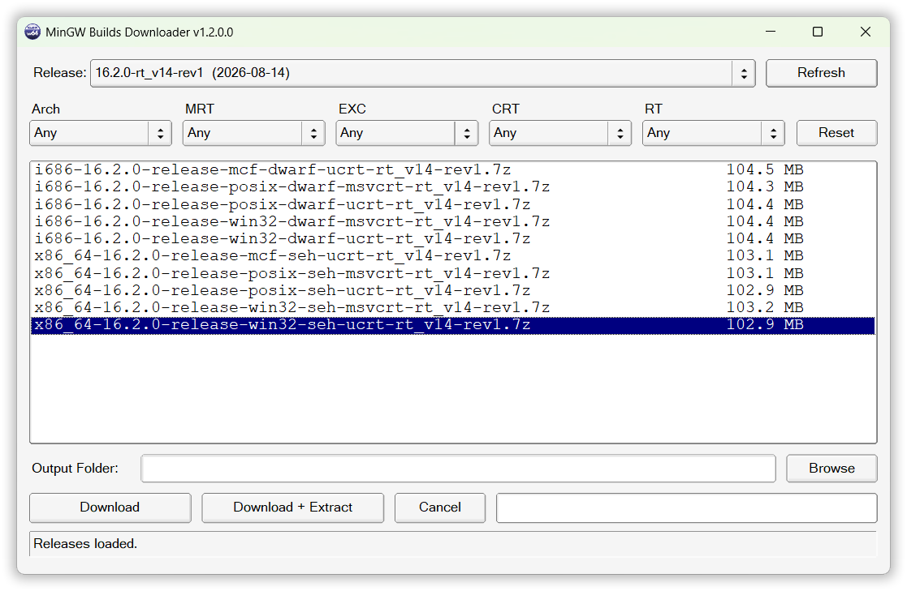

# MinGW Builds Downloader

[](https://www.virustotal.com/gui/file/62de86dbb51d07f2b9e54aea91d17bb0e500869464190c2bf9c63bc370aa753e/detection)
[](https://github.com/laisuk/MingwDownloader/releases)

A lightweight native Windows GUI utility for downloading and extracting
prebuilt **MinGW-w64 binaries** from:

[MinGW-w64 binaries (niXman)](https://github.com/niXman/mingw-builds-binaries)

Built with:

- C++17
- FLTK (native GUI)
- libcurl (HTTPS download)
- libarchive (7z extraction)
- nlohmann/json
- Fully static MinGW build
- No external dependencies
- No 7z.exe required

---



---

## ✨ Features

- Browse official MinGW-w64 releases

- Filter builds by:

    - Architecture (i686 / x86_64)
    - Thread model (posix / win32 / mcf)
    - Exception model (seh / dwarf)
    - CRT (ucrt / msvcrt)

- Download selected archive

- Optional **Download + Extract**

- Extraction to:

      out_dir / artifact_name /

- Progress bar for:

    - Download progress
    - Extraction progress (entry-based counting)

- Cancel support

- Native Windows folder picker (modern COM dialog)

- Fully static portable executable

- Small binary size (~2--3 MB)

- Clean VirusTotal result (0/72)

------------------------------------------------------------------------

## 📦 Why This Tool?

Many MinGW users:

- Do not want to manually browse GitHub releases
- Do not want to manually extract .7z archives
- Want a quick portable way to get a working toolchain

This utility provides a smooth, responsive GUI experience with no
freezing UI.

------------------------------------------------------------------------

## 🧠 Architecture

The application is properly threaded:

- UI thread handles rendering and input
- Worker thread handles:
    - HTTP download
    - Archive entry counting
    - Extraction
- Communication via `Fl::awake()` (FLTK-safe mechanism)

This ensures:

- Smooth UI
- Responsive cancel button
- No "Not Responding" Windows state

------------------------------------------------------------------------

## 🔒 Security & Clean Build

- No external 7z.exe execution
- No runtime unpacking
- No self-modifying behavior
- Fully static binary
- No dynamic loading of SSL backends
- Clean VirusTotal scan

------------------------------------------------------------------------

## 🛠 Build Instructions

Requires CMake >= 3.23 and a compatible x64 MinGW-w64 compiler on PATH.
FLTK 1.4.5 is built from source using CMake FetchContent (only `fltk::fltk`).
The remaining dependencies are bundled in `vcpkg/windows-mingw`; installing vcpkg or
referring to `D:/lib/vcpkg` is no longer necessary for MinGW builds.

**Binary origin:** these `x64-mingw-static` libraries were compiled with **x86_64-win32-seh-msvcrt** MinGW (win32
threads, SEH exceptions, MSVCRT).
Use a matching compiler ABI; the locally verified compiler is GCC 14.2.0.
See [the SDK notice](vcpkg/windows-mingw/NOTICE.md) for versions and licenses.

Configure in a fresh build directory (old caches may retain external paths):

```powershell
cmake -S . -B build -G "MinGW Makefiles" -DCMAKE_BUILD_TYPE=Release
cmake --build build -j 4
```

The repository toolchain is selected automatically. To specify it explicitly:

```powershell
cmake -S . -B build -G "MinGW Makefiles" -DCMAKE_BUILD_TYPE=Release -DCMAKE_TOOLCHAIN_FILE=vcpkg/windows-mingw/scripts/buildsystems/vcpkg.cmake
```

For Debug, use a separate build directory and `-DCMAKE_BUILD_TYPE=Debug`.
CI can use the same commands after installing the matching MinGW compiler;
FLTK source is fetched on first configure unless already populated; no
package-manager bootstrap is needed.

### MSVC (Visual Studio 2022, x64)

Dependencies are also bundled in `vcpkg/windows-msvc` as `x64-windows-static`.
CMake selects the SDK automatically after detecting MSVC, including with Ninja
and CLion. The adapter selects the matching static CRT (`/MT`, or `/MTd` in Debug).
See [the MSVC SDK notice](vcpkg/windows-msvc/NOTICE.md) for provenance and licenses.

From a x64 Visual Studio developer shell:

```powershell
cmake -S . -B build-msvc -G Ninja -DCMAKE_BUILD_TYPE=Release -DVCPKG_TARGET_TRIPLET=x64-windows-static
cmake --build build-msvc
```

In CLion, select the x64 Visual Studio toolchain. The existing Release profile's
`-DVCPKG_TARGET_TRIPLET=x64-windows-static` is supported. Reset the CMake cache if
it retains an external toolchain or old dependency paths. Debug uses a separate
build directory and `-DCMAKE_BUILD_TYPE=Debug`.

To select the SDK explicitly, pass
`-DCMAKE_TOOLCHAIN_FILE=vcpkg/windows-msvc/scripts/buildsystems/vcpkg.cmake`.
The MSVC CI workflow uses this SDK without cloning or bootstrapping vcpkg.
An explicit external `CMAKE_TOOLCHAIN_FILE` or `VCPKG_WDIR` still takes precedence
when you want to use an external dependency installation.

The resulting executable is fully static and portable.

------------------------------------------------------------------------

## 📄 License

This project is released under the MIT License.

MinGW builds are provided by the original maintainers:
https://github.com/niXman/mingw-builds-binaries

------------------------------------------------------------------------

## 👤 Author

Created by Laisuk Lai

Generated on: 2026-02-25 11:17:36 UTC
